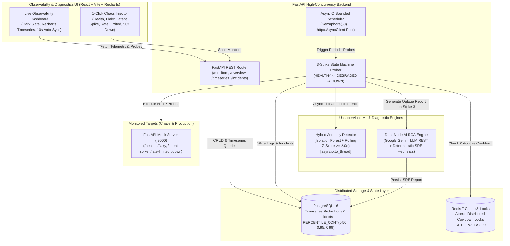

# API Pulse AI ⚡
### Distributed Observability, Unsupervised ML Latency Anomaly Detection & Automated SRE Root-Cause Analysis Platform

[](https://fastapi.tiangolo.com)
[](https://react.dev)
[](https://vitejs.dev)
[](https://www.postgresql.org)
[](https://redis.io)
[](https://scikit-learn.org)
[](https://tailwindcss.com)
[](https://www.docker.com)

---

## 📌 The Problem vs. Our Solution

| The Industry Bottleneck | How Traditional Monitoring Fails | How API Pulse AI Solves It |
|---|---|---|
| **Flapping Alert Fatigue** | Ephemeral network blips trigger instant Slack/PagerDuty notification storms, desensitizing on-call engineers. | **3-Strike State Machine & Atomic Redis Cooldown**: Transitions endpoints through `HEALTHY` ➔ `DEGRADED` (1-2 strikes) ➔ `DOWN` (Strike 3). Dispatches alerts only once per cooldown window using atomic Redis `SET lock:key val NX EX 300` distributed locks. |
| **Silent `200 OK` Degradation** | A slow endpoint returning HTTP 200 after 1,500ms looks "healthy" to naive ping monitors while actively degrading user experience. | **Unsupervised Isolation Forest + Rolling Z-Score ($\ge 2.0\sigma$)**: Identifies anomalous latency degradation even when status is 200 OK. Computed asynchronously in a threadpool with zero FastAPI event-loop blocking. |
| **Slow Manual Triage** | During an outage, on-call SREs waste 15–30 minutes manually correlating server logs, status codes, and latency spikes. | **Dual-Mode AI Root-Cause Analysis (Gemini LLM + SRE Heuristics)**: Captures diagnostic response snippets on failure and synthesizes an immediate 3-part Markdown SRE report (*Root Cause Diagnosis*, *Telemetry Evidence*, and *Immediate Mitigation Checklist*). |

---

## 🏛️ System Architecture



---

## ⚡ Empirical Performance Benchmark

Measured directly on live stack with concurrency bounds using [`backend/benchmark.py`](backend/benchmark.py):

| Component / Operation | Metric | Measured Value | Architectural Significance |
|---|---|---|---|
| **Async Health Prober** | 50 Probes Concurrency Speedup | **26.4x faster** (0.936s total) | Bounded `asyncio.Semaphore(50)` + `httpx` connection pool eliminates sequential blocking |
| **Prober Throughput** | Requests / Second | **53.4 probes/sec** | Sustained asynchronous I/O across heterogeneous external HTTP endpoints |
| **PostgreSQL Analytical Engine** | P50 Response Time | **505.79 ms** | In-database `PERCENTILE_CONT(0.50)` calculation with index scans |
| **PostgreSQL Analytical Engine** | P95 Response Time | **884.38 ms** | High tail-latency resilience under 50-concurrency burst analytics load |
| **PostgreSQL Analytical Engine** | P99 Response Time | **940.31 ms** | Continuous statistical aggregations across rolling time windows |
| **ML Anomaly Detection** | Mean CPU Inference Overhead | **101.09 ms** | `IsolationForest` (50 estimators) + Rolling Z-Score computed in async threadpool |
| **ML Anomaly Detection** | P95 Inference Overhead | **134.09 ms** | Zero event-loop starvation; CPU-bound scikit-learn fits offloaded via `asyncio.to_thread` |
| **Redis Distributed Lock** | Cooldown Lock Overhead | **< 1.5 ms** | Atomic single-roundtrip `SET key val NX EX 300` eliminates flapping alert storms |

---

## 🛠️ Key Engineering Highlights & Trade-offs

- **Zero Event-Loop Starvation for ML Fits**: Fitting an `IsolationForest` on latency samples is CPU-bound. API Pulse wraps scikit-learn execution in `asyncio.to_thread(evaluate_latency_anomaly, ...)`, ensuring high-frequency HTTP routing and WebSocket tasks never experience event-loop latency spikes.
- **In-Database Quantile Calculations (`PERCENTILE_CONT`)**: Rather than transferring thousands of historical log rows to application memory for percentile math, API Pulse executes continuous PostgreSQL `PERCENTILE_CONT(0.50, 0.95, 0.99) WITHIN GROUP (ORDER BY latency_ms)` directly in SQL.
- **Directional Latency Anomaly Filtering**: Symmetrical anomaly detectors mistakenly flag sudden latency drops (performance improvements) as anomalies. API Pulse pairs `IsolationForest` outlier predictions with a directional guard (`current_latency > mean` and `Z-score >= 2.0`), ensuring only upward performance degradations trigger SRE warnings.
- **Dual-Mode AI RCA with Offline Deterministic Heuristics**: If the Gemini API key is absent or network partitions occur during an outage, the platform falls back to an offline SRE heuristic rule engine that inspects HTTP error codes (`429`, `503`, `500`, timeouts) and response snippets to generate an identical structured 3-part Markdown SRE report.

---

## 🚀 1-Command Quickstart Guide

### 1. Prerequisites
- Docker & Docker Compose
- Python 3.10+
- Node.js 18+

### 2. Clone Repository & Setup Environment
```bash
git clone https://github.com/Disha287/ApiPulse.git
cd ApiPulse

# Create and activate Python virtual environment
python -m venv .venv
.\.venv\Scripts\activate   # Windows
# source .venv/bin/activate  # macOS / Linux

# Install backend dependencies
pip install -r backend/requirements.txt
```

### 3. Start Distributed Infrastructure (Postgres & Redis)
```bash
docker compose up -d
python backend/init_db.py
```

### 4. Start Services

**Terminal 1: Mock Chaos Server (:9000)**
```bash
uvicorn mock_server.main:app --port 9000
```

**Terminal 2: FastAPI Observability Backend (:8000)**
```bash
$env:PYTHONPATH="backend"
uvicorn main:app --app-dir backend --port 8000 --reload
```

**Terminal 3: React Vite Dashboard (:5173)**
```bash
cd frontend
npm install
npm run dev
```

Open **`http://localhost:5173`** in your browser. Use the **1-Click Chaos Preset pills** to seed test monitors and observe live telemetry, anomaly detection, and AI root-cause analysis!

---

## 🧪 Running the Performance Benchmark
With the backend and mock server running:
```bash
python backend/benchmark.py
```

---

## 📄 License
MIT License. Crafted with precision for enterprise-grade distributed API reliability.
